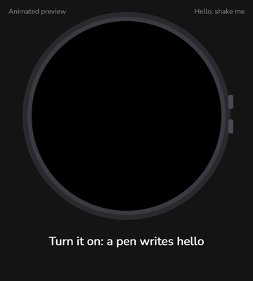

# Hello, shake me — Kindness

**A tiny round screen that says hello, and gives you a kind word when you shake it.**

*A personal project by [alirahmaniq](https://alirahmaniq.github.io).*


<p align="center"></p>

<p align="center"><sub>Animated preview of the firmware (not a screen recording) · <a href="docs/demo.mp4">watch the MP4</a></sub></p>

Kindness is open-source firmware for a palm-sized, battery-powered round AMOLED board. It greets you
with a hand-written **"hello"** and a little **"shake me"** that wiggles for attention. Shake it, and one
of five animated kindness messages plays — each with its own scene and its own gentle music. No app, no
account, no internet: just pick it up, shake, smile.

---

## What it does

**1. Hello.** A glowing pen writes *hello* in pastel handwriting. Two butterflies fly in and land on the
word — a lilac one on the "h", a pink one on the "o" — and rest there, slowly opening and closing their
wings. The word floats gently and a soft glint of light sweeps across it every few seconds. Underneath, *shake me* fades in and gives a
little wiggle — with tiny vibration arcs — every three seconds.

**2. Shake → a kind message.** Three quick shakes play the next message in order (the 6th shake starts
again at the first):

| # | Message | Animation |
|---|---------|-----------|
| 1 | *Your presence is a present to the world.* | A gift box pops up, its lid wobbles and flies off in a burst of sparkles, and the words rise out of the box. |
| 2 | *hey stranger! You are so loved and you make the world a better place* | An envelope opens, a card slides out and the note is hand-written line by line; a heart beats, little hearts float up and a paper plane flies away. |
| 3 | *I'm proud of you!* | Big hand-written words with a smiley drawn underneath and hearts drifting outwards. |
| 4 | *Be gentle with yourself. You're doing better than you think.* | A warm sun rises with slowly turning rays. |
| 5 | *Even the longest night ends with a sunrise. Keep going.* | A night sky with twinkling stars and a crescent moon. |

**3. Music.** Every message has its own short, hopeful melody (soft bell tones) that plays for exactly
as long as the message is on screen and fades out with it.

**4. Back to hello.** A few seconds after a message finishes, it fades back to the hello screen.
Pressing **BOOT** or **PWR** returns immediately. Shakes during a message are ignored, so it never
interrupts itself.

## The device

[Waveshare ESP32-S3-Touch-AMOLED-1.75C](https://www.waveshare.com/esp32-s3-touch-amoled-1.75c.htm) —
an off-the-shelf development board that looks and feels like a smartwatch module.

| Part | Details |
|------|---------|
| Processor | ESP32-S3R8, dual-core Xtensa LX7 up to 240 MHz, Wi-Fi + Bluetooth 5 (LE) |
| Memory | 512 KB SRAM, 8 MB PSRAM, 32 MB flash |
| Screen | 1.75″ round AMOLED, 466 × 466, CO5300 driver over QSPI |
| Touch | CST9217 capacitive touch |
| Motion | QMI8658 6-axis accelerometer + gyroscope — used for the shake |
| Audio | ES8311 codec, speaker, dual microphones (ES7210) |
| Power | AXP2101 power management, 3.7 V Li-ion battery connector with charging, USB-C |
| Buttons | PWR and BOOT |

Kindness uses the screen, the motion sensor, the speaker, the power chip and the buttons. Everything
runs on the board — there are **no image or sound files**: every frame is drawn and every note is
synthesised in real time.

## Under the hood

- **Own 2D renderer (`g2d`)** — anti-aliased paths, Bézier curves, arcs, rotation, transparency,
  soft glows and smooth text, drawn into a 466×466 frame buffer in PSRAM. No GPU and no graphics
  library beyond the display driver.
- **Font pipeline** — `tools/make_fonts.py` turns open-source TrueType fonts into compact anti-aliased
  glyph tables (only the characters the app uses, ~47 KB in total). The "hello" is pre-rendered as one
  image so the script letters join exactly like the font draws them.
- **Real-time music** — a small bell synthesiser on the second CPU core mixes up to 24 voices at
  16 kHz and streams them to the ES8311 codec over I2S. Each message has a melody whose length is
  computed to end exactly when the message does.
- **Shake detection** — three jolts above 1.2 g within one second, from the accelerometer, sampled in
  its own task so a shake is never missed while the screen is busy.
- **Faster screen updates** — an optional patch to the display library overlaps pixel conversion with
  DMA transfers (measured: 46 ms → 34 ms per full-screen frame).

## Build and flash

You need the board, a USB-C cable and [arduino-cli](https://arduino.github.io/arduino-cli/)
(or the Arduino IDE).

1. Install the ESP32 Arduino core (3.3.x):
   ```bash
   arduino-cli config add board_manager.additional_urls https://espressif.github.io/arduino-esp32/package_esp32_index.json
   arduino-cli core update-index
   arduino-cli core install esp32:esp32
   ```
2. Get the board libraries from Waveshare's
   [ESP32-S3-Touch-AMOLED-1.75C repository](https://github.com/waveshareteam/ESP32-S3-Touch-AMOLED-1.75C)
   (`examples/arduino/libraries`) and copy **GFX Library for Arduino 1.6.4**, **SensorLib 0.3.3**,
   **XPowersLib 0.2.6** and **Mylibrary** (`pin_config.h`) into your Arduino `libraries` folder.
3. Compile and upload (replace `COM4` with your port):
   ```bash
   arduino-cli compile -b esp32:esp32:esp32s3:CDCOnBoot=cdc,FlashSize=32M,PartitionScheme=app5M_fat24M_32MB,PSRAM=opi Kindness
   arduino-cli upload -b esp32:esp32:esp32s3:CDCOnBoot=cdc,FlashSize=32M,PartitionScheme=app5M_fat24M_32MB,PSRAM=opi -p COM4 Kindness
   ```

**Arduino IDE:** board *ESP32S3 Dev Module*, USB CDC On Boot *Enabled*, Flash Size *32MB*,
Partition Scheme *32M Flash (4.8MB APP/22MB FATFS)*, PSRAM *OPI PSRAM*.

> **Tip:** with a battery connected the board keeps running when unplugged. If the port disappears,
> hold PWR to switch it off, then hold BOOT while switching on to enter download mode.

**How to use it:** see [HOW_TO_USE.md](HOW_TO_USE.md).

**Try it without shaking:** open the serial monitor at 115200 baud and send `s` (shake),
`b` (button) or `1`–`5` (play that message).

## Make it yours

| What | Where |
|------|-------|
| Message texts, colours, timing and scenes | `messages.cpp` (each message is one small drawing function) |
| Melodies and volume (default 2 of 10) | `audio.cpp` (`INTRO*`, `PROG`, `FINAL`) and `audio.h` (`VOLUME`) |
| Shake sensitivity | `Kindness.ino` (`SHAKE_THRESHOLD_G`, `SHAKE_JOLTS_NEEDED`) |
| How long a message stays, fade time | `Kindness.ino` (`HOLD_SEC`, `FADE_SEC`) |
| Fonts and characters | `tools/make_fonts.py`, then rebuild (`font_types.h` / `fonts.h` are generated) |

## Project layout

```
Kindness/
  Kindness.ino      app flow: hello, shake, messages, buttons, timing
  messages.cpp/.h   the hello screen and the five animated messages
  g2d.cpp/.h        anti-aliased 2D renderer
  audio.cpp/.h      bell synthesiser + ES8311 audio output
  fonts.h           generated glyph tables + the "hello" image
  font_types.h      generated glyph structures
  es8311.*          ES8311 codec driver (Espressif, Apache-2.0)
  HOW_TO_USE.md     user guide
  docs/             demo video (MP4) and GIF
  licenses/         font licences (SIL OFL)
```

## Why this matters — ideas for products and research

Kindness is small, but the idea behind it — **a physical object that answers a simple gesture with a
moment of encouragement** — opens up a lot of directions.

### Product ideas

- **Digital greeting cards and gifts** — a keepsake that replays personal messages from family,
  friends or a partner; a modern take on the paper kindness card that inspired it.
- **Corporate and event gifting** — branded welcome devices for new employees, conference speakers or
  customers, with messages and music in the company's voice.
- **Wellbeing companions** — a calm, screen-light alternative to phone notifications for people who
  live alone, for older adults, or for anyone who wants a daily nudge without social media.
- **Classrooms and therapy rooms** — a playful reward or "calm down" object for children; teachers or
  therapists can swap in their own messages.
- **Hospitality and retail** — "shake to reveal" moments in hotel rooms, shops, museums and pop-ups:
  a greeting, a tip, a story or a promotion.
- **Kits and education** — a showcase project for makers and students: graphics, motion sensing and
  sound on a low-cost microcontroller, fully open source.

### Research directions

- **Positive-psychology micro-interventions** — affirmations, gratitude and self-compassion prompts are
  studied as brief wellbeing interventions; a dedicated tangible device is a low-cost way to deliver
  them and to explore how *physical interaction* changes engagement compared with phone apps.
- **Tangible and calm technology (HCI)** — how a deliberate gesture (shaking) versus push
  notifications affects attention, perceived intrusiveness and long-term use.
- **Loneliness and social connection** — devices that carry messages from loved ones, especially for
  older adults or people living far from family.
- **Behaviour change and motivation** — well-timed encouragement ("just-in-time" support) for
  exercise, study or recovery routines.
- **Embedded graphics on microcontrollers** — the renderer shows that smooth, anti-aliased, animated
  interfaces are possible on an inexpensive MCU without a GPU, which matters for low-cost and
  low-power product design.

*These are directions to explore, not tested claims — if you study or build on any of them, I would
love to hear about it.*

## Roadmap

- [x] Butterflies that land on "hello" and rest with moving wings
- [ ] Add your own messages from a phone over Bluetooth
- [ ] More languages and right-to-left scripts
- [ ] Deep sleep between shakes for weeks of battery life

## Feedback

Ideas, kind words and suggestions are very welcome — feel free to open an issue.

## Credits and licences

- © 2026 alirahmaniq. All rights reserved — see [Copyright](#copyright) below.
- ES8311 driver: © Espressif Systems, Apache-2.0 (via Waveshare's examples).
- Libraries used at build time: GFX Library for Arduino (BSD), SensorLib and XPowersLib (MIT),
  Waveshare board files (Apache-2.0).
- Fonts (SIL Open Font License 1.1): **Sacramento**, **Caveat**, **Lora**, **Nunito** from Google Fonts —
  converted into glyph tables in `fonts.h` (licence texts in `licenses/`).
- Messages 1–3 were inspired by a "random act of kindness" card; messages 4–5 are original.

## Copyright

© 2026 alirahmaniq. All rights reserved.

You're welcome to look at this project, learn from it and try it on your own device for personal use.
If you'd like to use it — or a version of it — in a product, service, publication or any commercial
work, please [get in touch](https://alirahmaniq.github.io) and ask first. See LICENSE.

---

Made with care by [alirahmaniq](https://alirahmaniq.github.io). If this made you smile, give it a ⭐ and
pass it on.
